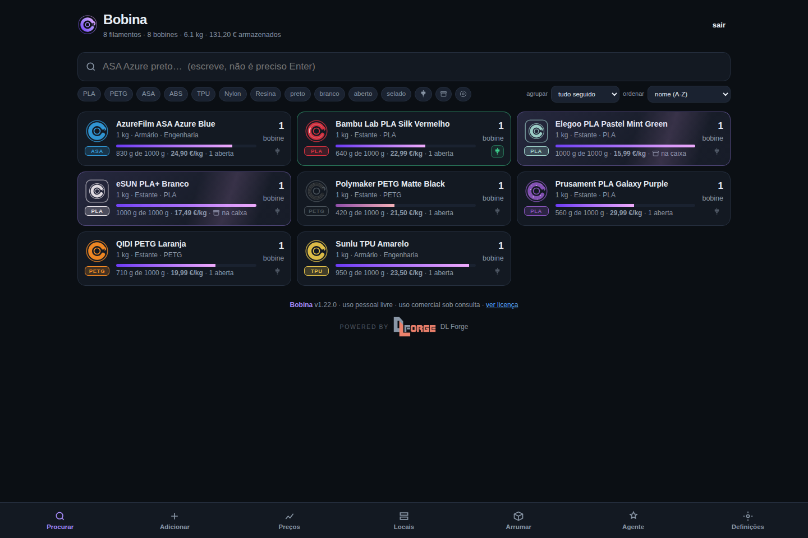
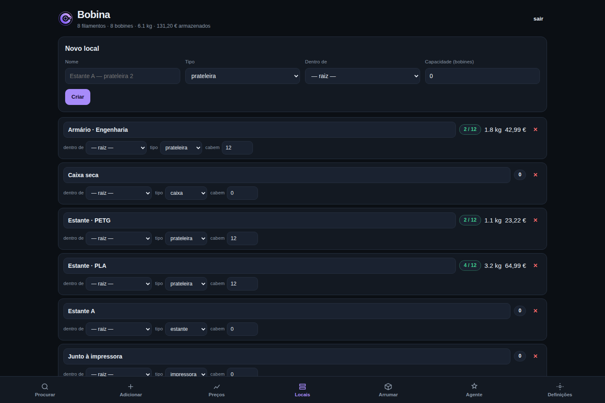

# Bobina — 3D filament logistics

[Português](../README.md)

An inventory for 3D-printing filament: what I have, where it is, how much is left, what it costs in each shop — plus an agent that helps tidy it all up.

Standard-library Python, **no dependencies**: it runs on the system `python3`. It serves on `:8100` and keeps everything in a SQLite file at `~/.local/share/bobina/bobina.db`.

## Screenshots

The real app with a demo inventory. Names, quantities and prices are examples, not current shop quotes.

## What it does

**Instant search.** Type and the list filters — no Enter, no button. The trick is the lexicon (`lexicon.py`): 700+ synonyms for brands, materials, colours and formats, in Portuguese and English. `ASA Azure Preto` finds an *AzureFilm ASA Black*; `grey` finds *Cinzento*; `azu` is enough for AzureFilm to show up. "Azure" is deliberately both a brand **and** a colour — it matches both.

**Prices.** Six shops (`lojas.py`): Evolt, Core XY and RepRap PT (Portugal), QIDI EU, Elegoo EU and Amazon. Each shop receives the text as typed **plus** the Portuguese and English versions — languages add up and never replace each other, so no shop is missed just because it catalogues in the other language. Prices refresh by themselves every 24 hours and the history is kept.

**Paste a link** and it counts as a search: put the product URL in the shop search box and Bobina reads it. Evolt is resolved by slug (WooCommerce search returns zero even when the page exists), the Shopify shops by `/products/<slug>.js`, and Amazon by the **ASIN** in `/dp/…` — on any domain, `.com` included, because the ASIN is the same everywhere. An Amazon price only counts when it comes in euros: the page returns the currency of whoever asks, and storing dollars in a field summed as euros would ruin every €/kg figure.

Every shop has its quirks. Evolt runs WooCommerce, whose search matches a contiguous *substring* of the title: `asa black` returns zero and `asa 1kg black` returns seven, because the "1kg" sits in the middle — so the app searches for the most selective term, paginates and filters locally with the lexicon. RepRap PT has its own platform and only answers with the full set of parameters (`terms` alone returns an empty page), but in return it reports weight and diameter in dedicated badges.

**Photos.** The shop photo is stored in `~/.local/share/bobina/imagens` and served by `/api/imagem` — the shop's own address was not enough, it breaks the day the shop moves its files. It uses the thumbnail the shop itself serves (7–20 KB instead of 300 KB) and only fetches images from the five shops' domains.

**Adding.** A shop result reaches the form already filled in: brand, material (with variant — `PETG Matte`, `PLA+`, `PETG CF`), colour, weight converted to grams and the colour as hex. The facets come from three sources, in this order: the title, the brand the shop itself declares, and the terms typed in the search. The scan works on **phrases** of up to three words, otherwise brands such as "Professional Lab" or "The Filament" would never match.

**Colours.** With no photo — or by preference — the spool is **drawn** in outline and painted from what the colour says: `dark grey`, `wood ash`, `silk red`, `purple-blue`, `Pastel Mint Green`, `negro azabache`. That is ~290 3D-printing colour names with modifiers (`dark`, `pastel`, `neon`, `matte`, `silk`), and compound colours blend. You can pick by hand from a swatch or an RGB wheel and go back to automatic whenever you like.

**Purchases.** Each spool records where it was bought (the six shops or any other, by hand), for how much and when. The card shows the average **€/kg**, weighted by weight, because the same reference may have been bought at different times and in different shops. Adding a spool that already exists **joins it to the group**: the comparison is by meaning, not by letters, so the same spool bought as "Black" in one shop and "Preto" in another lands in the same place.

**On the printer.** Each card has a printer nozzle under the count: grey means nothing is mounted, green means something is. Clicking mounts the spool that is **closest to running out** (the oldest on a tie) — the one you want to use up first — and clicking again removes them all. To choose another, open the filament and mark the spool there; the card lights up all the same, and only goes dark when none inside is marked. Several can be mounted at once, for multi-colour printing. It is not a spool state: a mounted spool is still *open*. When adding a spool you can also mark it straight away, next to the packaging — only when adding one at a time, because mounting three at once would be a lie.

**Asking about status.** Three chips with just an icon — the nozzle, the box and the spool — list what is **on the printer**, what still has a **box** and what has **run out**. They are not separate switches: they write the term into the search box, and typing `na impressora`, `com caixa`, `sem caixa` or `bobina` by hand does the same. They combine with each other and with the text — `PLA na impressora sem caixa` looks for a spool that is all three things at once, not a filament with one of each. The three signals — green symbol, green outline and green veil — are switched on and off one by one in *Settings* (the veil is off by default).

**Appearance.** In *Settings* you can force the drawing or the photo on every spool, toggle the material label and mark the **unopened** ones — it only changes what you see, never what is stored. A group in which *all* spools are still sealed can carry two things, switched separately: a **purple veil**, always noticeable, and a **glint** that slowly sweeps across (much more pause than sweep, and none at all if the system asks for reduced motion). The glint alone is enough to give the signal without painting the card. Opening one spool is all it takes for the group to stop being marked.

**What did not fit.** Card lines never wrap, so all cards have the same height; when the text is cut, hovering opens a tooltip with the rest. Only when it is really cut — a tooltip that always shows is noise.

**Views.** The list is shown flat or grouped by **location**, **brand**, **material**, **sub-material** or **colour**, with sub-sorting (name, most filament, most spools, most recently added). The choice is remembered. Material has two levels: *by material* groups everything that is PLA — PLA+, PLA Silk, PLA Wood, HT-PLA — and is the same reading as the card label, while *by sub-material* separates what is written on each filament. When grouping by colour, "Jet Black", "Preto" and "Traffic Black" all fall into the same group — grouping by the raw text gave one group per spool.

In the **by location** view, a filament spread over two shelves appears in both, and each card counts only what is there: that is what the sorting uses, and the card says **how many spools** it belongs to and **where the others are** — in place of the shelf, which the group header already states.

**Storage.** Locations form a tree (room › cupboard › shelf › box) with capacity, and the list draws that tree: what is inside something else appears nested inside it. Name, type, capacity and "inside of" can be changed at any time; the "inside of" field never offers the location itself or one already inside it, and the server refuses it anyway — a loop of locations would make the path to the root never end. Each location says how many spools it holds, how much unused filament is there and **how much that filament is worth** — all three always sum the subtree, so a cupboard shows what is in its drawers. The top of the app closes the account: kilos and euros in storage, over the same set of spools. The value comes from what was paid for each spool (price divided by the weight it came with, times what remains); without its own price it uses the filament's average €/kg, and without either it is left out — summing less is better than inventing a price. The agent (`agente.py`) proposes names and where to put each spool; **Preview** writes nothing, **Apply** applies and stores the reversal so it can be **undone**. Claude, GPT, Gemini or DeepSeek, your choice in Settings.

**Tidy-up (for after a move).** A tab with the pile of what has no place yet on the left and the containers on the right. Drag from one to the other with the mouse, or with a finger on a tablet (hold for a moment and drag; sliding straight away keeps scrolling the list) — or tap the spool and then the container. The containers **are the locations**: what you arrange here holds for the list, the agent and Fatia.

Each container states what it **accepts**: a type (plain PLA, special PLA — wood, silk, LW/foam, glitter, metallic, CF, HD —, PETG, Engineering — ABS, ASA, PC, Nylon, TPU —, Other) or a material, and optionally only certain colour families and/or only sealed/opened spools. Shelves without rules inherit those of the cupboard. From there each spool in the pile comes with a suggested place (a chosen material weighs more than a type; identical spools stay together; capacity is respected, also when placing several at once). Colour families come from the **drawn** colour and not from the text, so "Glacier White", "Branco" and "Rapid White" are all white.

The pile can be viewed by colour, by type, all of it, or in **random rounds** of 5–6 spools to hunt through the middle of the heap. There is "put in suggested place" per group or for everything, and step-by-step undo. **New move** returns everything to the pile (printers may stay) and can delete the old containers; a snapshot of the before is kept — each spool shows "before: …", the **+** offers the old containers with rules inferred from what was in them, and the whole move can be undone at once (deleted containers come back with the same id).

**Resins.** A material is a resin when the name says so ("Resina ABS-like", "Water-Washable Resin"…): the rule lives in one place, `lexicon.py` (`RESINA_RE`), and goes to the browser with the rest of the lexicon. A **bottle** is drawn instead of the spool, with the liquid in the resin's colour and at the height of what remains. When adding from a shop, the material gets its subtype ("Resina ABS-like", "Resina 8K", "Resina Flexível"…) and storage knows three families: regular resins (standard, water-washable, plant-based, 8K), ABS-like, and technical (tough, flexible, high temperature, casting, dental, engineering). In the shops, resins only show when you search for resin — a search for "ABS" does not fill up with "ABS-like Resin" — and weight also reads volumes ("500ml" ≈ 550 g, from the typical density of 1.1 g/ml). The Fatia bridge reports `tipo: "resina"` or `"filamento"` for each material.

**Bridge to Fatia.** [Fatia](https://github.com/hubertdungen/fatia) picks filaments from here **live**, without importing anything: `/api/fatia/filamentos` returns, per filament, the real cost per kilo (from what was actually paid), the best price seen in the shops, how much material is still at home, in which locations, and the **colour already resolved to hex** — `lexicon.cor_hex()` is the same algorithm the browser runs in `corDe()`, so the drawn spool comes out identical in both apps. Nothing to configure: both apps run on this machine and talk through a secret in `~/.local/share/bobina/bridge.token`.

## Files

| | |
|---|---|
| `server.py`  | API, SQLite, authentication, price tracking |
| `lexicon.py` | PT/EN synonyms — served at `/api/lexicon`, shared with the browser |
| `lojas.py`   | shop adapters (Woo, PrestaShop, Shopify, HTML) |
| `agente.py`  | the tidy-up agent; returns a plan, never writes |
| `index.html` | the whole app, in one file |

## Getting started

Nothing to install besides Python 3 (10 or newer). No `pip`, no `node`, no database running alongside.

    git clone https://github.com/hubertdungen/bobina.git
    cd bobina
    python3 server.py --port 8100

Open `http://localhost:8100`, create the account on the first visit (it owns the inventory) and you are done. Data lives in `~/.local/share/bobina/`.

The tidy-up agent needs an API key — Claude, GPT, Gemini or DeepSeek, your choice in *Settings*. The rest of the app works without one. The interface is in European Portuguese.

## Maintenance

    ~/scripts/bobina-server.sh {start|stop|restart|status}
    ~/scripts/bobina-backup.sh          # DB + repo into 2_CONFIG (cron 03:05)

It starts at boot and is checked every 5 minutes by cron.

## Licence

Source-available, not open source. **Free for personal use; commercial use needs a licence agreed with the author** — [`LICENSE`](../LICENSE) (English, prevails) and [`LICENCA.md`](../LICENCA.md) (Portuguese).

The shops mentioned have no connection with this project. The prices the app shows are read from their public pages, are informational and go stale — always confirm on the shop's site before buying.

<a href="https://dlforge.dungenlabs.com"><picture><source media="(prefers-color-scheme: dark)" srcset="branding/dlforge-logo-negative.svg"><source media="(prefers-color-scheme: light)" srcset="branding/dlforge-logo.svg"></picture></a>

